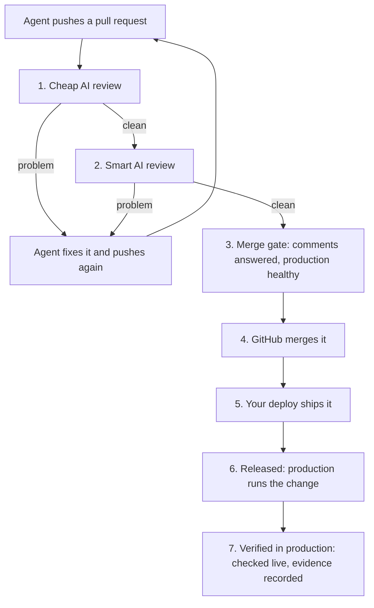

# Sheriff

**Agents code. The Sheriff decides what merges.**

[](https://github.com/nick-the-dev/gh-sheriff/actions/workflows/ci.yml)
[](LICENSE)
[](https://cli.github.com/manual/gh_extension)

Sheriff is a GitHub CLI extension that turns a repository into a place where AI agents can open pull requests safely.
Every new pull request head gets an independent AI review in CI, cheap model first, and GitHub itself refuses to merge
anything that review has not passed. Admins can't bypass it either. Work items move through their stages as pull
requests merge and releases land.

It does not care what runs your agents: Claude Code, Codex, LobeHub, a CI bot or a person. Everything lives in
GitHub, so the rules are the same for all of them.

```sh
gh extension install nick-the-dev/gh-sheriff
gh sheriff install
```

## Why

Agents write code faster than anyone can read it. The usual guard rails don't hold up:

- **Agents review their own work**, or a sibling agent does, in the same session that wrote it.
- **Review is a convention, not a gate.** A comment saying "LGTM" does not stop a merge.
- **Agents hold admin credentials**, so any rule the repository has can be skipped with `--admin`.
- **Smart models are expensive**, and running the best one on every change burns the budget.

Sheriff moves the rules into GitHub, where agents can't argue with them. The review runs in CI on keys the agents never
see. The verdict is a check run that only Sheriff's App can write. A no-bypass ruleset requires that check.

## Features

- **Independent review, cheap first.** A cheap first pass (an OpenCode model, or a small Claude model) reviews every
  new head. Only a clean first pass reaches the final reviewer, Claude Opus by default. Docs-only changes stop at the
  cheap pass.
- **A round budget that can't be gamed.** Each pull request gets 3 cheap rounds, then 3 final rounds. After that a
  maintainer decides. Each round is recorded by Sheriff's App *before* any model runs, so cancelling, re-running,
  closing or force-pushing never buys another.
- **A verdict nobody else can write.** The `Review` check run belongs to your gate App and is bound to the exact head
  and its merge base. It records which model ran and the tokens it used.
- **A merge gate for people and production.** `Merge gate` stays red until every comment from a person has an agent's
  answer. If you configure it, it also waits until production serves the default branch, is healthy, and its last
  deploy succeeded.
- **No bypass, no admin merges.** One ruleset requires both from the gate App, admins included. Auto-merge merges
  the moment everything is green, so agents never need an admin login.
- **Work state that keeps itself.** Issues carry a `Stage`. It moves from Candidate through In progress, Merged and
  Released to Verified, driven by pull requests and deploys. A project board shows what needs you.
- **Spend you can see.** `gh sheriff stats` shows how much of the review work the expensive model did. The target is
  under 10%.
- **Fixes without pull requests.** Your repository calls Sheriff's shared workflows at `@v1`. Fixes released under
  `v1` reach you automatically; breaking changes get a new major version.

## How it works



1. **Cheap review.** A low-cost model reviews every new push. Docs-only changes stop here.
2. **Smart review.** Only a clean cheap review reaches the smart model, Claude Opus by default.
3. **Merge gate.** Every comment from a person needs an agent's answer, and production must be healthy (if you
   configured it).
4. **Merge.** GitHub merges the pull request as soon as everything is green. Nobody can bypass this, admins included.
5. **Deploy.** Your own deploy workflow runs as usual and tells Sheriff when it is done.
6. **Released.** Sheriff sees that production serves the merged commit and moves the task to Released.
7. **Verified.** An agent (or a person) exercises the change in production and records what it saw with
   `gh sheriff task verify`. The task becomes Verified and its issue closes. Work marked "Release only" needs no live
   check and is verified as soon as it is released. A Verified set by hand, without that record, is moved back.

Each review round is counted before the AI starts. Cancelling or re-running a review never buys an extra attempt.

Under the hood:

- The verdict is a `Review` check run that only your Sheriff App can write.
- Pull request code is only ever read, never run.
- Reviewer keys and the App key live in separate environments.

[Security model](#security-model) has the details.

## Quick start

**You need:**

- admin rights on the repository;
- the [GitHub CLI](https://cli.github.com) logged in;
- Python 3.9 or newer;
- a [supported reviewer](#supported-reviewers): a Claude subscription, and optionally OpenCode Go for the cheap
  first pass.

```sh
gh extension install nick-the-dev/gh-sheriff
cd your-repo
gh sheriff install
```

`install` is safe to run again; every step checks first and only changes what is missing. It:

1. creates the environments `sheriff` and `sheriff-review`, both limited to the default branch;
2. creates your account's gate App in the browser (one click) and stores its key in `sheriff`;
3. asks for your reviewers and stores their keys in `sheriff-review`;
4. opens a pull request adding the two trigger files. Sheriff reviews that pull request, and it merges itself;
5. turns on auto-merge and creates the `Sheriff` ruleset. Your existing required checks are kept;
6. sets up work state: three issue fields, a "Main project" board with its views, and Auto-add on the board.

Then check everything with:

```sh
gh sheriff doctor
```

It works for organisations and personal accounts alike.

## Supported reviewers

Sheriff runs reviews on subscriptions you already pay for. Two are supported today:

| Subscription | Use it for | Reviewer value | Key (asked by `install`) |
|---|---|---|---|
| **Claude** (any plan that includes Claude Code), through Claude Code | The final reviewer (Opus by default), or a cheap first pass with a small Claude model | `claude:claude-opus-5-5`, `claude:claude-haiku-5-5` | `CLAUDE_CODE_OAUTH_TOKEN`, from `claude setup-token` |
| **[OpenCode Go](https://opencode.ai)** | The cheap first pass | `opencode:opencode-go/deepseek-v4.1-flash` (or any `opencode-go/` model) | `OPENCODE_API_KEY` |

Reviews count against these plans; no per-token API billing is involved.

Not supported yet:

- Anthropic API keys;
- OpenAI, Codex or other providers;
- OpenCode models outside Go.

Either subscription can fill either role. The setup Sheriff is tuned for is OpenCode Go for the cheap pass and Claude
Opus for the final one. With a Claude subscription alone, use a small Claude model for the cheap pass, or none.

```sh
gh sheriff models                          # interactive
gh sheriff models --first-pass opencode:opencode-go/deepseek-v4.1-flash --review-model claude:claude-opus-5-5
gh sheriff stats                           # how much the smart model did, and what it cost
```

## Commands

| Command | What it does |
|---|---|
| `gh sheriff install` | Set Sheriff up on a repository. Flags: `--repo`, `--yes`, `--first-pass`, `--review-model`, `--no-files`, `--no-work-state`, `--project-name`, `--new-key`, `--rotate-secrets`, `--no-browser` |
| `gh sheriff doctor` | Check every piece of the setup and say what to fix |
| `gh sheriff models` | Choose the cheap and the final reviewer |
| `gh sheriff stats` | Review usage on recent pull requests: share of tokens by the final model, cost, and a warning above `--limit` |
| `gh sheriff task new "<title>"` | Open a task issue at Candidate, already on the board |
| `gh sheriff task set <ID\|#n>` | Set what facts can't show: `--stage Parked`, `--next "who acts next"`, `--verify` |
| `gh sheriff task verify <ID\|#n> --evidence-file F` | Record production evidence for the released merge, set Verified and close the issue. Refuses work that is not Released |
| `gh sheriff task status` | Open work by stage, blocked work, decisions, and issues where a person spoke last |
| `gh sheriff task reply <ID\|#n> --body-file F` | Answer a person on an issue |
| `gh sheriff task sync [--apply]` | What CI runs to move stages; without `--apply` it only reports |

## Configuration

**Repository variables** (all optional except the two `install` sets):

| Variable | Default | Meaning |
|---|---|---|
| `SHERIFF_FIRST_PASS` | none | Cheap reviewer, `provider:model` |
| `SHERIFF_REVIEW_MODEL` | `claude:claude-opus-5-5` | Final reviewer |
| `SHERIFF_FIRST_PASS_ROUNDS` / `SHERIFF_REVIEW_ROUNDS` | `3` / `3` | Round budget per pull request |
| `SHERIFF_UNLOCK_AUTHORS` | none | Logins, besides admins and maintainers, whose unedited `/sheriff review` allows one more final round. Never the PR's author |
| `SHERIFF_ACK_AUTHORS` | none | Logins, besides bots, whose replies answer a person's comment |
| `SHERIFF_VERSION_URL` | none | URL returning JSON with the deployed `sha`. `Merge gate` waits until it serves the default branch |
| `SHERIFF_HEALTH_URL` | none | Must answer 200 for `Merge gate` to pass |
| `SHERIFF_DEPLOY_WORKFLOW` | none | Deploy workflow file. Its last run must have succeeded |
| `SHERIFF_OVERRIDE` | none | One pull request number that skips the production part (break-glass) |
| `SHERIFF_SMART_SHARE_LIMIT` | `10` | Target smart-model share for `stats`, in percent |
| `SHERIFF_WORK_STATE` | set by `install` | `on` turns on the work-state job |
| `SHERIFF_APP_ID`, `SHERIFF_APP_SLUG` | set by `install` | Name the gate App |
| `SHERIFF_RUNS_ON` | `ubuntu-latest` | Keep GitHub-hosted runners. Never point this at a persistent runner that pull requests also use |

**Environments**, both limited to the default branch:

| Environment | Secrets |
|---|---|
| `sheriff` | `SHERIFF_APP_ID`, `SHERIFF_APP_KEY_B64`: the gate App, used only to reserve rounds and post verdicts and statuses |
| `sheriff-review` | `CLAUDE_CODE_OAUTH_TOKEN` and/or `OPENCODE_API_KEY`: only what your reviewers need |

**Your deploy workflow** should end with:

```yaml
- run: gh workflow run sheriff.yml --ref main -f after_run="$GITHUB_RUN_ID"
  env:
    GH_TOKEN: ${{ github.token }}   # the job needs actions: write
```

## Answering a comment

A comment from a person holds `Merge gate` until an agent answers it. The answer must come from a bot, or from a login
in `SHERIFF_ACK_AUTHORS`, and its last line must be:

```html
<!-- sheriff-ack -->
```

`gh sheriff task reply` adds the marker for you on issues.

## Work state

Each piece of work is one issue whose title starts with its task id: `LOGIN-FIX: fix the login page`. A pull request
names its task by ending its title with `(LOGIN-FIX)`, or with a branch whose last part is the id (`ai/LOGIN-FIX`).

| Field | Values | Set by |
|---|---|---|
| `Stage` | Candidate, In progress, Merged, Released, Verified, Parked | Sheriff, from facts. People set Parked or Candidate, and record Verified with `task verify` |
| `Verify by` | Release only, Live check, Awaits event | Whoever opens the work |
| `Next action` | One line: who acts next and what | Whoever touched it last |

| Fact | Stage |
|---|---|
| An open pull request from this repository names the task | In progress |
| Its latest merge into the default branch | Merged |
| Production serves a commit containing the merge (or the deploy run succeeded, or, with neither configured, the merge itself) | Released |
| Released, and `Verify by` is Release only | Verified, with an evidence comment; the issue closes |

How stages behave:

- Only Sheriff marks Verified: a hand-set Verified without recorded evidence is moved back on the next sync.
  Evidence is a comment whose last line is `<!-- sheriff-verified sha=… -->`, naming the task's latest merge.
  `task verify` and the automatic release verification write it. Moved back, the stage follows the facts (at most
  Released), a closed issue reopens, and one comment says why.
- Otherwise stages never move backwards on their own.
- Decisions never move.
- Pull requests from forks never mark work In progress.
- Every run is idempotent.

The board's views are Needs you, Blocked, Ready, In flight, Awaiting verification, and All open by stage.

## Security model

- **Keys are split.** The gate App's key and the reviewer keys sit in different environments, both limited to the
  default branch. No job holds both, and no job that reads pull request content holds the App key.
- **Pull request code never runs with secrets.** Every trigger runs the default branch's copy of `sheriff.yml`. The
  relay has no permissions. The reviewer reads the head as data, with read-only tools, no shell, and symlinks removed.
- **The verdict belongs to one head.** A check run is bound to the head and its merge base. A new push needs a new
  review, and an unchanged head is never reviewed twice.
- **Rounds can't be re-rolled.** The round is recorded before the model runs. A re-run of only part of a workflow
  doesn't review. A review edited by anyone but the App blocks until a maintainer unlocks it.
- **The installer only merges what it wrote.** Its pull request is one commit on top of the default branch, checked by
  sha and file list before merging.
- Sheriff's own CI runs its tests, [actionlint](https://github.com/rhysd/actionlint) and
  [zizmor](https://github.com/zizmorcore/zizmor) on every change.

## Limits

- **An AI reviewer can be talked to.** It reads text the pull request's author wrote. It is told to treat that text as
  data, but a crafted change could still try to argue for a clean verdict.
- **You trust Sheriff's `v1` tag.** `sheriff.yml` passes your secrets to Sheriff's workflows (`secrets: inherit`)
  because environment secrets reach a shared workflow no other way. Sheriff's jobs only read their own. Release tags
  are protected, so only Sheriff's maintainer can move them. If you'd rather review every update, replace `@v1` with
  a commit sha.
- **One gate App per account.** Any repository's copy of the key can mint tokens for the others. In an organisation
  where different people administer different repositories, give those repositories separate gate Apps.
- **Fork pull requests aren't reviewed automatically yet.** GitHub doesn't link `workflow_run` events to pull requests
  from forks. A maintainer runs `gh workflow run sheriff.yml -f pr=<n> -f review=true`.
- **The budget is per pull request.** A new pull request from the same branch starts a new budget.
- **Deleted comments.** A writer can still delete a person's comment, which removes its hold on `Merge gate`.
- **Same-user agents.** Agents that run as your own OS user can read whatever that user can, including an admin `gh`
  login. Sheriff closes the sanctioned paths; full isolation needs agents that run as another user or in a sandbox.
- **Auto-add needs one click.** GitHub has no API to switch on a board's "Auto-add to project". `install` opens the
  page and waits for you, and `doctor` checks it.

## Development

```sh
for t in tests/*.test.py; do python3 "$t"; done
actionlint .github/workflows/*.yml templates/*.yml
zizmor --offline .github/workflows/ templates/ actions/
```

Everything is the Python standard library plus `gh`. Shared workflows live in `.github/workflows/` (`gate.yml`,
`review.yml`, `state.yml`), their steps in `actions/`, the scripts in `scripts/`, and the files a repository copies in
`templates/`.

Releases:

- `v1` is a moving tag. Fixes move it.
- A change that needs new permissions in a repository's `sheriff.yml` is a new major version, because a shared
  workflow can never ask for more than its caller grants.

Issues and pull requests are welcome.

## License

[MIT](LICENSE)
