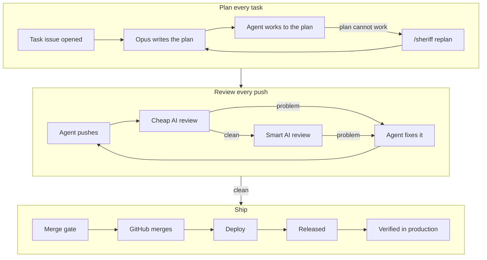

<p align="center">
  
</p>

<h1 align="center">Sheriff</h1>

<p align="center">
  A GitHub CLI extension that reviews every pull request with AI in CI,<br>
  and only lets it merge when the review passes.
</p>

<p align="center">
  <a href="https://github.com/nick-the-dev/gh-sheriff/actions/workflows/ci.yml"></a>
  <a href="LICENSE"></a>
  <a href="https://cli.github.com/manual/gh_extension"></a>
</p>

Sheriff is for repositories where AI agents open pull requests. One command sets up:

- a plan from Claude Opus on each task issue, before the work starts (see [Planning](#planning));
- an AI review on every push. A cheap model goes first, and Claude Opus reviews only if that passes;
- a ruleset that blocks merging until the review passes. Admins can't bypass it either;
- task tracking with GitHub Issues and a GitHub Projects board. Each task's status follows its pull request and your
  deploys.

It is built entirely on GitHub: Actions, a GitHub App, rulesets, Issues and Projects. So it works with any agent tool,
such as Claude Code, Codex or LobeHub, and with people too.

```sh
gh extension install nick-the-dev/gh-sheriff
cd your-repo
gh sheriff install
```

## How a pull request gets merged



0. If planning is on, Sheriff posts a plan on the task issue first (see [Planning](#planning)). `Merge gate` waits for
   that plan, and the review checks the pull request against it.
1. An agent pushes to a pull request.
2. A cheap model reviews the diff. If it finds a problem, the `Review` check fails and the agent pushes a fix. Changes
   that only touch docs stop here.
3. If the cheap review is clean, Claude Opus reviews the same diff.
4. The `Merge gate` check passes when these hold:
   - the task issue has a current Sheriff plan and the `Review` was made against that plan version, if planning is on;
   - every comment from a person has an agent reply (a comment that is only a Sheriff command, such as `/sheriff review`, needs none);
   - production is healthy, if you configured a health check.

   If several pull requests have auto-merge on, only the lowest-numbered one that would pass gets a green `Merge gate`.
   The others stay pending ("one merge per deploy: waiting for #N") until it merges, so merges follow one per deploy.
   Bundle merges let several merge per deploy (see [Merges](#merges)).
5. When `Review` and `Merge gate` are both green, GitHub merges the pull request automatically.
6. Your deploy workflow runs. When production serves the merged commit, Sheriff marks the task Released.
7. Someone checks the change in production and records it with `gh sheriff task verify`. The task becomes Verified.

Each pull request gets 3 cheap and 3 Opus reviews. After that, a maintainer has to comment `/sheriff review` to allow
one more. A review counts as soon as it starts, so cancelling or re-running it doesn't give a free retry.

## Requirements

- Admin rights on the repository.
- [GitHub CLI](https://cli.github.com), logged in.
- Python 3.9 or newer.
- A Claude subscription, and optionally OpenCode Go (see [Reviewers](#reviewers)).
- Runners. By default Sheriff runs on GitHub-hosted runners, which bill Actions minutes on private repositories,
  and Sheriff runs on every pull request event. Plan for self-hosted runners (see [Runners and Actions minutes](#runners-and-actions-minutes)).

## Install

```sh
gh extension install nick-the-dev/gh-sheriff
gh sheriff install --repo owner/name
gh sheriff doctor --repo owner/name
```

`install` works for organisations and personal accounts. You can run it again safely: it only adds what is missing.
It does the following:

1. Creates two environments that only the default branch can use: `sheriff` for the GitHub App key, and
   `sheriff-review` for the reviewer keys.
2. Creates a GitHub App for your account (one click in the browser). Only this App can post the `Review` and
   `Merge gate` results.
3. Asks which reviewers to use and stores their keys.
   A new install also turns planning on (`--plan off` skips it) and sets `SHERIFF_PLAN_SINCE`. If the App cannot post
   plans yet, planning stays off and install prints how to grant the permission.
   A new install merges one pull request per deploy; `--merges bundle` batches them (see [Merges](#merges)).
4. Opens a pull request that adds `.github/workflows/sheriff.yml` and `sheriff-relay.yml`. Sheriff reviews that pull
   request, and it merges itself. It also lists your repository's workflows that run on pull requests in
   `sheriff.yml`, so the merge gate re-runs as soon as one of them finishes; those runs never start a review. Run
   `install` again after you add or rename such a workflow.
5. Turns on auto-merge and creates a ruleset named `Sheriff` that requires `Review` and `Merge gate`. Required checks
   you already have are kept.
6. Adds three issue fields to your account and creates a GitHub Projects board named `<repo> work`. Skip this with
   `--no-work-state`.

## Planning

With `SHERIFF_PLAN=on`, Claude Opus writes a plan on each task issue before the work starts. The plan is a comment
posted by Sheriff's App, with six sections:

- **Problem**: what is wrong or missing, and why it matters.
- **Solution space**: the options, with web research where it changes the answer, and why the others were rejected.
- **Chosen approach**: the design, the files to change, edge cases and risks. It is the minimal readable change: the
  smallest diff that solves the problem, still clear for a person to read. No clever compression, no drive-by
  refactors, no speculative options.
- **Tests**: the tests that prove the change, failing before and passing after.
- **Production check**: how to verify it after release.
- **Out of scope**: what the task must not touch.

Plans and reviews are written in plain language for someone who knows the project but not that part of the code: short
sentences, everyday words, each section or finding opening with one sentence that states its point, and any term or
internal name explained on first use.

Only task issues are planned: those whose title starts with a task ID (`<ID>: ...` or `<ID> #n: ...`). Decision issues
and pull requests never are. An issue a person opens without an ID is named first, when it would be planned: Sheriff
renames it to `<WORDS>-<number>: <your title>`, three words of the title plus the issue number, so `Login page broken
on mobile` (#57) becomes `LOGIN-PAGE-BROKEN-57: Login page broken on mobile`, and its start comment says so. Within a
minute of opening, the issue carries its task ID and "Sheriff is writing plan v1". Issues opened by bots are not renamed.

The plan binds the pull request. `Merge gate` stays pending ("needs a Sheriff plan on #N") until the task issue has a
current plan, and the review gets the plan and checks the pull request against it. A different approach, files outside
the plan or missing planned tests, without a replan, is a blocking finding. Only a plan comment by Sheriff's App counts,
so nobody can paste one in. A pull request's task issue is the one it closes, or else the open issue whose title starts
with the ID in the pull request title (`(LOGIN-FIX)`). Pull requests with neither are not gated.

**Who triggers planning.** An issue opened by a bot, an admin, a maintainer or a login in `SHERIFF_ACK_AUTHORS` is planned
at once. For anyone else's issue, one of those people comments `/sheriff plan`. An issue that already has a plan is not
planned again, and open issues are not planned in bulk. Only comments from those trusted authors reach the planner.

**Changing a plan.** Comment `/sheriff replan <reason>` on the issue. The planner treats the reason as a claim to check
against the code, not as an instruction, and writes the next version. The gate and the review use the latest version,
and a new version allows one more review of an unchanged pull request head.

**Budget and unlocks.** An issue gets at most `SHERIFF_PLAN_ROUNDS` plans (default 3). After that Sheriff posts a budget
notice, and an admin, a maintainer or a login in `SHERIFF_UNLOCK_AUTHORS` comments `/sheriff plan` to allow one more.
The person who asked for the replan can't unlock it.

**The 2-failure rule.** If the planner fails twice in a row (a crash, a timeout or a plan that doesn't pass the format
check), Sheriff stops and posts the budget notice. A maintainer's `/sheriff plan` allows another try.

**Web access.** `SHERIFF_PLAN_WEB` sets what the planner can reach on the web:

| Value | Planner can | Risk |
|---|---|---|
| `search` (default) | Search the web | Low: it never fetches a URL |
| `allowlist` | Search, and fetch pages on the domains in `SHERIFF_PLAN_FETCH_DOMAINS` | Text in an issue can make it fetch from those domains only |
| `any` | Search, and fetch any URL | Text in an issue could make it send what it has read to an outside URL |

Use `any` only if you trust everyone who can open issues in the repository. The planner runs read-only, with no shell, but
a fetch is an outbound request.

**Exemptions.** Pull requests opened before `SHERIFF_PLAN_SINCE` are not gated. `install` sets it when planning is
switched on, and switching on again after off restarts it. An admin can label a pull request `sheriff:no-plan` for an
emergency, and the gate says so in its description.

**App permission.** Posting plans and naming issues need the App's repository permission Issues: Read and write. Apps created by an
earlier Sheriff only have read. To grant it, open the App's settings, then Permissions, set Repository permissions >
Issues to Read and write and save. Then accept the new permission request on the installation (an organization owner
has to). Until then, a new install leaves planning off, and `--plan on` stops with these steps. `gh sheriff doctor`
checks this, and `gh sheriff stats` lists plans next to reviews, outside the smart-model share.

## Merges

`SHERIFF_MERGE_MODE` sets how many pull requests may merge per deploy. A new install sets `serial`.
`gh sheriff install --merges bundle` (or `--merges serial`) switches it, and `install` without `--merges` keeps the
current value. Bundles need the `sheriff.yml` from this Sheriff version; an older one stays serial.

**Serial (the default).** One pull request per deploy. Only the lowest-numbered auto-merge pull request that would pass
gets a green `Merge gate`, and with production checks configured only once the last merge is deployed. The others wait
with "one merge per deploy: waiting for #N".

**Bundle.** Up to `SHERIFF_BUNDLE_MAX` (default 5) merged pull requests wait for one deploy. Sheriff counts the commits
merged since the commit production serves: the `sha` from `SHERIFF_VERSION_URL`, or without it the newest successful
run of `SHERIFF_DEPLOY_WORKFLOW` on the default branch. Prefer `SHERIFF_VERSION_URL`: if your deploy workflow lets a
replaced run conclude success, the newest successful run can name a newer commit than production serves, so Sheriff
counts too few merges and a bundle can grow past the cap. The free slots go to the lowest-numbered auto-merge pull
requests that would pass. The others stay pending with "waiting for a bundle slot behind #N", or "bundle full: K
merged pull requests wait for the deploy" when no slot is left.

A deploy on its way doesn't hold a bundle back: production may serve an older commit and a deploy run may still be
going. A failed deploy does: if the newest finished run of `SHERIFF_DEPLOY_WORKFLOW` on the default branch (skipped
and cancelled runs aside) did not succeed, every pull request waits until a deploy succeeds, and a failed deploy of the
default branch's head fails them all. A version or health endpoint that is not 200, or a count Sheriff cannot read,
also blocks every pull request. `SHERIFF_OVERRIDE` lets one pull request, such as a revert, merge past a full bundle
or a failed deploy.

Nothing caps a bundle when Sheriff has nothing to count from: neither `SHERIFF_VERSION_URL` nor
`SHERIFF_DEPLOY_WORKFLOW` is set (`gh sheriff doctor` warns about that), or only the deploy workflow is set and it has
no successful run on the default branch yet. With squash merges one pull request is one commit; with merge commits or
rebase merges a bundle fills sooner.

**The trade-off.** Each pull request in a bundle is still planned, reviewed and tested on its own; the rest of the gate
is unchanged. The combination is tested only after it merges, by the default branch's CI and the deploy's health
check. If that fails, you bisect or revert up to `SHERIFF_BUNDLE_MAX` pull requests instead of one.

Let a newer build cancel an older one on the default branch (`cancel-in-progress: true` in the `concurrency` of the
workflow that builds what you deploy). Then a bundle builds and ships once, at its newest commit, instead of once per
merge.

## What your agents need

Sheriff reports through check runs, commit statuses and pull request reviews. The identity your agents push with
(a GitHub App, a bot account or a fine-grained token) needs these repository permissions to work through that loop
on their own:

| Permission | Why |
|---|---|
| Contents: read and write | Push branches |
| Pull requests: read and write | Open pull requests, turn on auto-merge, read Sheriff's review |
| Issues: read and write | Comment on task issues and reply to people |
| Checks: read | Read the `Review` check run and why it failed. Without it an agent cannot see Sheriff's verdict |
| Commit statuses: read | Read `Merge gate` and why it is pending |
| Actions: read and write | Read CI logs, and re-run a flaky job instead of pushing an empty commit |
| Workflows: read and write | Push changes under `.github/workflows/`. GitHub refuses those pushes without it |
| Projects: read and write | Only if your agents move items on the work board themselves (organisation boards) |

None of these let an agent merge on its own: the `Sheriff` ruleset still requires `Review` and `Merge gate`, which only
Sheriff's App can post.

## Reviewers

Reviews run on subscriptions, not on pay-per-token API keys.

| Subscription | Use it for | Model setting | Key |
|---|---|---|---|
| Claude (any plan that includes Claude Code) | The Opus review, or a cheap review with a small model | `claude:claude-opus-5-5`, `claude:claude-haiku-5-5` | `CLAUDE_CODE_OAUTH_TOKEN`, from `claude setup-token` |
| [OpenCode Go](https://opencode.ai) | The cheap review | `opencode:opencode-go/deepseek-v4.1-flash`, or any `opencode-go/` model | `OPENCODE_API_KEY` |

Not supported yet:
- Anthropic API keys;
- OpenAI or Codex;
- OpenCode models outside Go.

Run `gh sheriff models` to change reviewers. `gh sheriff stats` shows how much of the review work Opus did and what it
cost; aim for under 10%.

## Commands

| Command | Description |
|---|---|
| `gh sheriff install` | Set up a repository. Flags: `--repo`, `--first-pass`, `--review-model`, `--plan on\|off`, `--merges serial\|bundle`, `--no-work-state`, `--project-name`, `--no-files`, `--yes` |
| `gh sheriff doctor` | Check the setup and print what to fix |
| `gh sheriff models` | Choose the cheap and the Opus reviewer |
| `gh sheriff stats` | Show review and plan usage and cost for recent pull requests |
| `gh sheriff task new "<title>"` | Create a task issue and add it to the board |
| `gh sheriff task set <ID>` | Set fields Sheriff can't infer: `--stage Parked`, `--next "..."`, `--verify` |
| `gh sheriff task verify <ID> --evidence-file F` | Record what was checked in production. Sets Verified and closes the issue |
| `gh sheriff task status` | List open tasks by stage, blocked tasks, and comments waiting for a reply |
| `gh sheriff task board-status [--apply]` | Backfill: set the board's built-in `Status` to each item's `Stage` where they differ (dry run without `--apply`) |
| `gh sheriff task reply <ID> --body-file F` | Reply to a person's comment on an issue |

## Configuration

All settings are repository variables. All are optional.

| Variable | Default | Description |
|---|---|---|
| `SHERIFF_FIRST_PASS` | none | Cheap reviewer, e.g. `opencode:opencode-go/deepseek-v4.1-flash` |
| `SHERIFF_REVIEW_MODEL` | `claude:claude-opus-5-5` | Final reviewer |
| `SHERIFF_FIRST_PASS_ROUNDS`, `SHERIFF_REVIEW_ROUNDS` | `3`, `3` | Reviews allowed per pull request |
| `SHERIFF_PLAN` | `on` for a new install whose App can post plans, else off | `on` turns planning on. Anything else means off |
| `SHERIFF_PLAN_SINCE` | set by `install` | Pull requests opened before this time (UTC, `2026-11-22T00:00:00Z`) need no plan |
| `SHERIFF_PLAN_MODEL` | `claude:claude-opus-5-5` | Planner model |
| `SHERIFF_PLAN_ROUNDS` | `3` | Plans allowed per issue |
| `SHERIFF_PLAN_TURNS` | `40` | Turns the planner may take per plan |
| `SHERIFF_PLAN_WEB` | `search` | `search`, `allowlist` or `any` (see [Planning](#planning)) |
| `SHERIFF_PLAN_FETCH_DOMAINS` | none | Comma-separated domains the planner may fetch, with `allowlist` |
| `SHERIFF_VERSION_URL` | none | A URL returning JSON with the deployed commit as `sha`. Used for `Merge gate` and Released |
| `SHERIFF_HEALTH_URL` | none | `Merge gate` fails unless this URL returns 200 |
| `SHERIFF_DEPLOY_WORKFLOW` | none | Deploy workflow file. `Merge gate` fails if its last run failed |
| `SHERIFF_OVERRIDE` | none | A pull request number that may merge despite failing production checks or a full bundle |
| `SHERIFF_MERGE_MODE` | `serial` | `bundle` lets up to `SHERIFF_BUNDLE_MAX` merged pull requests wait for one deploy. Anything else means serial (see [Merges](#merges)) |
| `SHERIFF_BUNDLE_MAX` | `5` | Merged pull requests one deploy may carry in bundle mode. A value that is not a whole number of at least 1 means 5 |
| `SHERIFF_ACK_AUTHORS` | none | Logins, other than bots, that count as agents when replying to comments, and as trusted authors for planning |
| `SHERIFF_UNLOCK_AUTHORS` | none | Logins, other than admins and maintainers, allowed to grant an extra review with `/sheriff review` or an extra plan with `/sheriff plan` |
| `SHERIFF_RUNS_ON` | `ubuntu-latest` | Runner label for the gate, reviews and work state (see [Runners and Actions minutes](#runners-and-actions-minutes)) |
| `SHERIFF_RELAY_RUNS_ON` | `ubuntu-latest` | Runner label for the relay |

`install` also sets `SHERIFF_APP_ID`, `SHERIFF_APP_SLUG` and `SHERIFF_WORK_STATE`.

Add this step at the end of your deploy workflow so Sheriff knows a deploy finished. The job needs `actions: write`.

```yaml
- run: gh workflow run sheriff.yml --ref main -f after_run="$GITHUB_RUN_ID"
  env:
    GH_TOKEN: ${{ github.token }}
```

A comment from a person blocks `Merge gate` until an agent replies. The reply must come from a bot, or from a login
in `SHERIFF_ACK_AUTHORS`, and its last line must be `<!-- sheriff-ack -->`.

## Runners and Actions minutes

**On a private repository, GitHub-hosted runners can use up your Actions minutes fast.** Sheriff runs a job on every
pull request event: the relay on each push, edit or review, the gate on each of those and after CI and deploys, and a
review on each new head. Each job is billed as at least one minute, and a model review takes several. One busy
repository with about 20 agent pull requests a day used about 940 GitHub-hosted minutes in a day, roughly a third of a
Team plan's monthly allowance. Use self-hosted runners unless the repository is public or quiet.

| Variable | Runs | What it needs |
|---|---|---|
| `SHERIFF_RUNS_ON` | Gate, reviews, verdicts, work state | A runner label. These jobs hold the gate App key and the reviewer keys, so give them runners that never run pull request code: one job per runner, and no Docker socket shared with CI jobs |
| `SHERIFF_RELAY_RUNS_ON` | The relay on pull request events | A runner label. The relay holds no secrets and runs the pull request's own copy of its workflow, so your normal CI runners are fine |

Both default to `ubuntu-latest`.

Self-hosted runners for Sheriff should be ephemeral: one job each. The planner and the reviewer read the job's workspace,
and a persistent runner shares that workspace with the repository's other jobs.

Sheriff's secrets stay in the `sheriff` and `sheriff-review` environments, which only
the default branch can use, so a job from a pull request branch cannot read them on any runner.

## Tracking work with Issues and Projects

Each task is a GitHub issue whose title starts with an ID, like `LOGIN-FIX: fix the login page`. A pull request
belongs to the task when its title ends with `(LOGIN-FIX)` or its branch is named like `ai/LOGIN-FIX`.

Sheriff stores the task state in three issue fields, which also appear as columns on the board. The board's built-in `Status` mirrors `Stage` on every write, which needs the Projects permission described under Configuration:

| Field | Values |
|---|---|
| `Stage` | Candidate, In progress, Merged, Released, Verified, Parked |
| `Verify by` | Release only, Live check, Awaits event |
| `Next action` | Free text: who does what next |

Sheriff updates `Stage` on its own:

| Event | New stage |
|---|---|
| A pull request for the task is opened | In progress |
| The pull request is merged | Merged |
| Production serves the merged commit, or the deploy succeeds (with no deploy configured: on merge) | Released |
| `gh sheriff task verify` records evidence, or the task is "Release only" and was released | Verified |

Stages don't move backwards. Pull requests from forks are ignored. Verified needs recorded evidence: if someone sets
it by hand, the next sync moves the task back and reopens the issue.

The board has these views:
- Needs human;
- Blocked;
- Ready;
- In flight;
- Awaiting verification;
- All open.

## Security

- The App key and the reviewer keys are in separate environments. No job that reads pull request content has the
  App key.
- The planner runs in `sheriff-review`, read-only, with no shell. It sees only comments from trusted authors. The App
  needs Issues: Read and write to post plans; with `SHERIFF_PLAN_WEB=any`, text in an issue could make the planner fetch
  an outside URL (see [Planning](#planning)).
- Pull request code is never executed. Every trigger runs the default branch's copy of `sheriff.yml`. The reviewer
  only gets read-only file tools, with no shell.
- The `Review` result is a check run that only your Sheriff App can write. It is tied to one commit and its merge
  base, so any new push needs a new review.
- A review is counted before the model runs. Re-running part of a workflow doesn't review again. An edited review
  blocks until a maintainer allows another.
- The installer only merges the single commit it created, after checking its sha and files.
- Secrets reach only the Sheriff steps that need them, by name; no workflow inherits all of a repository's secrets.
- Sheriff's own CI runs its tests, actionlint and zizmor on every change.

## Known limitations

- **Prompt injection.** The AI reviewer reads text the pull request author wrote. It is instructed to treat that
  text as data, but a crafted change could still try to talk it into passing.
- **Trusting `@v1`.** Your `sheriff.yml` runs Sheriff's actions at `@v1`, and the steps that need them get your
  Sheriff secrets by name (never your other secrets). Release tags are protected. If you want to review every update,
  pin a commit sha instead of `@v1`.
- **One App per account.** One GitHub App serves all of an account's repositories. Repositories with different
  admins should use separate Apps.
- **Forks.** Pull requests from forks aren't reviewed automatically. Start a review with
  `gh workflow run sheriff.yml -f pr=<n> -f review=true`.
- **Commands during a plan.** A `/sheriff plan` or `/sheriff replan` posted while a plan is being written is answered
  by a follow-up run after the plan is posted, so its reply comes a little later.
- **Per-PR limits.** The review limit counts per pull request. A new pull request starts with a fresh limit.
- **Status needs a permission.** The board's built-in `Status` mirrors `Stage` and needs the App's organization
  permission Projects: Read and write (`install` requests it for organization Apps; `doctor` checks it). GitHub Apps
  cannot write user-owned boards.
- **Auto-add.** The board's Auto-add has to be switched on in the browser, because GitHub has no API for it. `install`
  opens the page for you.

## Development

```sh
for t in tests/*.test.py; do python3 "$t"; done
actionlint .github/workflows/*.yml templates/*.yml
zizmor --offline .github/workflows/ templates/ actions/
```

Sheriff is standard-library Python and `gh`.

| Path | Contents |
|---|---|
| `.github/workflows/` | Reusable workflows |
| `actions/` | Their steps |
| `scripts/` | The logic |
| `templates/` | The two files `install` adds to a repository |

`v1` is a moving tag that receives fixes. A new permission that only jobs or inputs a new template adds ask for ships
in `v1`, because old templates never run those jobs. A changed permission on a job an old template already runs ships
as `v2`.

Issues and pull requests are welcome.

## License

[MIT](LICENSE)
