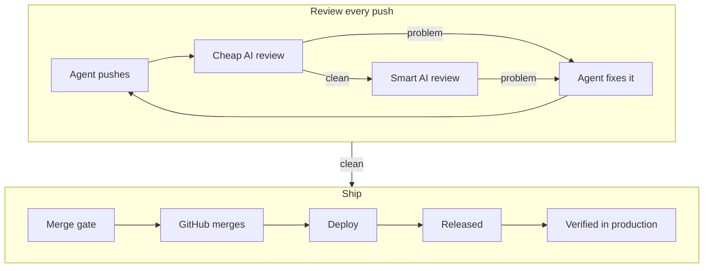

<p align="center">
  
</p>

<h1 align="center">Sheriff</h1>

<p align="center">
  A GitHub CLI extension that reviews every pull request with AI in CI,<br>
  and only lets it merge when the review passes.
</p>

<p align="center">
  <a href="https://github.com/nick-the-dev/gh-sheriff/actions/workflows/ci.yml"></a>
  <a href="LICENSE"></a>
  <a href="https://cli.github.com/manual/gh_extension"></a>
</p>

Sheriff is for repositories where AI agents open pull requests. One command sets up:

- an AI review on every push. A cheap model goes first, and Claude Opus reviews only if that passes;
- a ruleset that blocks merging until the review passes. Admins can't bypass it either;
- task tracking with GitHub Issues and a GitHub Projects board. Each task's status follows its pull request and your
  deploys.

It is built entirely on GitHub: Actions, a GitHub App, rulesets, Issues and Projects. So it works with any agent tool,
such as Claude Code, Codex or LobeHub, and with people too.

```sh
gh extension install nick-the-dev/gh-sheriff
cd your-repo
gh sheriff install
```

## How a pull request gets merged



1. An agent pushes to a pull request.
2. A cheap model reviews the diff. If it finds a problem, the `Review` check fails and the agent pushes a fix. Changes
   that only touch docs stop here.
3. If the cheap review is clean, Claude Opus reviews the same diff.
4. The `Merge gate` check passes when two things hold:
   - every comment from a person has an agent reply;
   - production is healthy, if you configured a health check.
5. When `Review` and `Merge gate` are both green, GitHub merges the pull request automatically.
6. Your deploy workflow runs. When production serves the merged commit, Sheriff marks the task Released.
7. Someone checks the change in production and records it with `gh sheriff task verify`. The task becomes Verified.

Each pull request gets 3 cheap and 3 Opus reviews. After that, a maintainer has to comment `/sheriff review` to allow
one more. A review counts as soon as it starts, so cancelling or re-running it doesn't give a free retry.

## Requirements

- Admin rights on the repository.
- [GitHub CLI](https://cli.github.com), logged in.
- Python 3.9 or newer.
- A Claude subscription, and optionally OpenCode Go (see [Reviewers](#reviewers)).

## Install

```sh
gh extension install nick-the-dev/gh-sheriff
gh sheriff install --repo owner/name
gh sheriff doctor --repo owner/name
```

`install` works for organisations and personal accounts. You can run it again safely: it only adds what is missing.
It does the following:

1. Creates two environments that only the default branch can use: `sheriff` for the GitHub App key, and
   `sheriff-review` for the reviewer keys.
2. Creates a GitHub App for your account (one click in the browser). Only this App can post the `Review` and
   `Merge gate` results.
3. Asks which reviewers to use and stores their keys.
4. Opens a pull request that adds `.github/workflows/sheriff.yml` and `sheriff-relay.yml`. Sheriff reviews that pull
   request, and it merges itself.
5. Turns on auto-merge and creates a ruleset named `Sheriff` that requires `Review` and `Merge gate`. Required checks
   you already have are kept.
6. Adds three issue fields to your account and creates a GitHub Projects board named `<repo> work`. Skip this with
   `--no-work-state`.

## Reviewers

Reviews run on subscriptions, not on pay-per-token API keys.

| Subscription | Use it for | Model setting | Key |
|---|---|---|---|
| Claude (any plan that includes Claude Code) | The Opus review, or a cheap review with a small model | `claude:claude-opus-5-5`, `claude:claude-haiku-5-5` | `CLAUDE_CODE_OAUTH_TOKEN`, from `claude setup-token` |
| [OpenCode Go](https://opencode.ai) | The cheap review | `opencode:opencode-go/deepseek-v4.1-flash`, or any `opencode-go/` model | `OPENCODE_API_KEY` |

Not supported yet:
- Anthropic API keys;
- OpenAI or Codex;
- OpenCode models outside Go.

Run `gh sheriff models` to change reviewers. `gh sheriff stats` shows how much of the review work Opus did and what it
cost; aim for under 10%.

## Commands

| Command | Description |
|---|---|
| `gh sheriff install` | Set up a repository. Flags: `--repo`, `--first-pass`, `--review-model`, `--no-work-state`, `--project-name`, `--no-files`, `--yes` |
| `gh sheriff doctor` | Check the setup and print what to fix |
| `gh sheriff models` | Choose the cheap and the Opus reviewer |
| `gh sheriff stats` | Show review usage and cost for recent pull requests |
| `gh sheriff task new "<title>"` | Create a task issue and add it to the board |
| `gh sheriff task set <ID>` | Set fields Sheriff can't infer: `--stage Parked`, `--next "..."`, `--verify` |
| `gh sheriff task verify <ID> --evidence-file F` | Record what was checked in production. Sets Verified and closes the issue |
| `gh sheriff task status` | List open tasks by stage, blocked tasks, and comments waiting for a reply |
| `gh sheriff task reply <ID> --body-file F` | Reply to a person's comment on an issue |

## Configuration

All settings are repository variables. All are optional.

| Variable | Default | Description |
|---|---|---|
| `SHERIFF_FIRST_PASS` | none | Cheap reviewer, e.g. `opencode:opencode-go/deepseek-v4.1-flash` |
| `SHERIFF_REVIEW_MODEL` | `claude:claude-opus-5-5` | Final reviewer |
| `SHERIFF_FIRST_PASS_ROUNDS`, `SHERIFF_REVIEW_ROUNDS` | `3`, `3` | Reviews allowed per pull request |
| `SHERIFF_VERSION_URL` | none | A URL returning JSON with the deployed commit as `sha`. Used for `Merge gate` and Released |
| `SHERIFF_HEALTH_URL` | none | `Merge gate` fails unless this URL returns 200 |
| `SHERIFF_DEPLOY_WORKFLOW` | none | Deploy workflow file. `Merge gate` fails if its last run failed |
| `SHERIFF_OVERRIDE` | none | A pull request number that may merge despite failing production checks |
| `SHERIFF_ACK_AUTHORS` | none | Logins, other than bots, that count as agents when replying to comments |
| `SHERIFF_UNLOCK_AUTHORS` | none | Logins, other than admins and maintainers, allowed to grant an extra review with `/sheriff review` |

`install` also sets `SHERIFF_APP_ID`, `SHERIFF_APP_SLUG` and `SHERIFF_WORK_STATE`.

Add this step at the end of your deploy workflow so Sheriff knows a deploy finished. The job needs `actions: write`.

```yaml
- run: gh workflow run sheriff.yml --ref main -f after_run="$GITHUB_RUN_ID"
  env:
    GH_TOKEN: ${{ github.token }}
```

A comment from a person blocks `Merge gate` until an agent replies. The reply must come from a bot, or from a login
in `SHERIFF_ACK_AUTHORS`, and its last line must be `<!-- sheriff-ack -->`.

## Tracking work with Issues and Projects

Each task is a GitHub issue whose title starts with an ID, like `LOGIN-FIX: fix the login page`. A pull request
belongs to the task when its title ends with `(LOGIN-FIX)` or its branch is named like `ai/LOGIN-FIX`.

Sheriff stores the task state in three issue fields, which also appear as columns on the board:

| Field | Values |
|---|---|
| `Stage` | Candidate, In progress, Merged, Released, Verified, Parked |
| `Verify by` | Release only, Live check, Awaits event |
| `Next action` | Free text: who does what next |

Sheriff updates `Stage` on its own:

| Event | New stage |
|---|---|
| A pull request for the task is opened | In progress |
| The pull request is merged | Merged |
| Production serves the merged commit, or the deploy succeeds (with no deploy configured: on merge) | Released |
| `gh sheriff task verify` records evidence, or the task is "Release only" and was released | Verified |

Stages don't move backwards. Pull requests from forks are ignored. Verified needs recorded evidence: if someone sets
it by hand, the next sync moves the task back and reopens the issue.

The board has these views:
- Needs human;
- Blocked;
- Ready;
- In flight;
- Awaiting verification;
- All open.

## Security

- The App key and the reviewer keys are in separate environments. No job that reads pull request content has the
  App key.
- Pull request code is never executed. Every trigger runs the default branch's copy of `sheriff.yml`. The reviewer
  only gets read-only file tools, with no shell.
- The `Review` result is a check run that only your Sheriff App can write. It is tied to one commit and its merge
  base, so any new push needs a new review.
- A review is counted before the model runs. Re-running part of a workflow doesn't review again. An edited review
  blocks until a maintainer allows another.
- The installer only merges the single commit it created, after checking its sha and files.
- Secrets reach only the Sheriff steps that need them, by name; no workflow inherits all of a repository's secrets.
- Sheriff's own CI runs its tests, actionlint and zizmor on every change.

## Known limitations

- **Prompt injection.** The AI reviewer reads text the pull request author wrote. It is instructed to treat that
  text as data, but a crafted change could still try to talk it into passing.
- **Trusting `@v1`.** Your `sheriff.yml` runs Sheriff's actions at `@v1`, and the steps that need them get your
  Sheriff secrets by name (never your other secrets). Release tags are protected. If you want to review every update,
  pin a commit sha instead of `@v1`.
- **One App per account.** One GitHub App serves all of an account's repositories. Repositories with different
  admins should use separate Apps.
- **Forks.** Pull requests from forks aren't reviewed automatically. Start a review with
  `gh workflow run sheriff.yml -f pr=<n> -f review=true`.
- **Per-PR limits.** The review limit counts per pull request. A new pull request starts with a fresh limit.
- **Auto-add.** The board's Auto-add has to be switched on in the browser, because GitHub has no API for it. `install`
  opens the page for you.

## Development

```sh
for t in tests/*.test.py; do python3 "$t"; done
actionlint .github/workflows/*.yml templates/*.yml
zizmor --offline .github/workflows/ templates/ actions/
```

Sheriff is standard-library Python and `gh`.

| Path | Contents |
|---|---|
| `.github/workflows/` | Reusable workflows |
| `actions/` | Their steps |
| `scripts/` | The logic |
| `templates/` | The two files `install` adds to a repository |

`v1` is a moving tag that receives fixes. Changes that need new permissions in `sheriff.yml` will ship as `v2`.

Issues and pull requests are welcome.

## License

[MIT](LICENSE)
