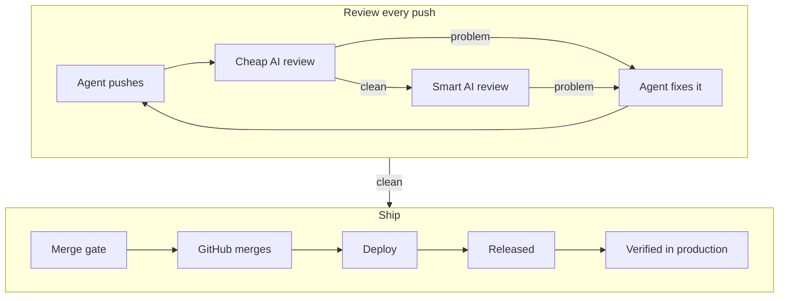

# Sheriff

**Agents code. The Sheriff decides what merges.**

[](https://github.com/nick-the-dev/gh-sheriff/actions/workflows/ci.yml)
[](LICENSE)
[](https://cli.github.com/manual/gh_extension)

Sheriff is a GitHub CLI extension for repositories where AI agents open pull requests. Every push gets an independent
AI review in CI, cheap model first. GitHub itself refuses to merge anything that review hasn't passed, and admins
can't bypass it. Work is tracked as **GitHub Issues** on a **GitHub Projects** board, and each task moves to Released
and Verified on its own.

Sheriff is built only from GitHub features: Actions, a GitHub App, rulesets, check runs, Issues and Projects. It
works the same whatever runs your agents: Claude Code, Codex, LobeHub, a bot or a person.

```sh
gh extension install nick-the-dev/gh-sheriff
gh sheriff install
```

**Why:** agents write code faster than anyone can read it. They review their own work, "LGTM" comments don't stop a
merge, agents hold admin logins that skip every rule, and running the best model on every change burns the budget.
Sheriff moves the rules into GitHub, where agents can't argue with them.

## How it works



**Review**
- **Cheap review.** A low-cost model reviews every new push. Docs-only changes stop here.
- **Smart review.** Only a clean cheap review reaches the smart model, Claude Opus by default.
- **Round budget.** Each pull request gets 3 cheap and 3 smart rounds, then a maintainer decides. Every round is
  counted before the AI starts, so cancelling or re-running never buys another try.

**Ship**
- **Merge gate.** Every comment from a person needs an agent's answer. Production must be healthy, if you configured
  it.
- **GitHub merges.** It merges the moment `Review` and `Merge gate` are green. Nobody can bypass that, admins
  included.
- **Deploy.** Your own deploy runs and tells Sheriff when it's done.
- **Released.** Sheriff sees production serving the merge and moves the task's issue to Released.
- **Verified.** An agent checks the change live and records evidence with `gh sheriff task verify`. Only Sheriff can
  set Verified.

## Quick start

You need:
- admin rights on the repository;
- the [GitHub CLI](https://cli.github.com), logged in;
- Python 3.9 or newer;
- a [supported subscription](#supported-reviewers).

```sh
gh extension install nick-the-dev/gh-sheriff
cd your-repo && gh sheriff install
gh sheriff doctor
```

`install` is safe to re-run, and works for organisations and personal accounts. It:
1. creates two environments, limited to the default branch: `sheriff` for the gate App, `sheriff-review` for the
   reviewer keys;
2. creates your gate App in one browser click;
3. asks which reviewers to use and stores their keys;
4. opens a pull request with two trigger files, which Sheriff reviews and auto-merges;
5. turns on auto-merge and creates the no-bypass `Sheriff` ruleset, keeping your existing required checks;
6. sets up work state:
   - three issue fields on your account;
   - a GitHub Projects board named `<repo> work`, with views and Auto-add.

## Supported reviewers

Reviews run on subscriptions you already pay for, with no per-token API billing.

| Subscription | Typical role | Reviewer value | Key |
|---|---|---|---|
| **Claude**, any plan with Claude Code | Smart review (or a cheap one with a small model) | `claude:claude-opus-5-5`, `claude:claude-haiku-5-5` | `CLAUDE_CODE_OAUTH_TOKEN` from `claude setup-token` |
| **[OpenCode Go](https://opencode.ai)** | Cheap review | `opencode:opencode-go/deepseek-v4.1-flash`, or any `opencode-go/` model | `OPENCODE_API_KEY` |

Not supported yet:
- Anthropic API keys;
- OpenAI or Codex;
- OpenCode models outside Go.

Switch reviewers with `gh sheriff models`. `gh sheriff stats` shows the smart model's share of the work and its cost;
the target is under 10%.

## Commands

| Command | What it does |
|---|---|
| `gh sheriff install` | Set up a repository (`--repo`, `--first-pass`, `--review-model`, `--no-work-state`, `--project-name`, `--no-files`, `--yes`) |
| `gh sheriff doctor` | Check the setup and say what to fix |
| `gh sheriff models` | Choose the cheap and the smart reviewer |
| `gh sheriff stats` | Review usage and cost on recent pull requests |
| `gh sheriff task new "<title>"` | Open a task issue, already on the board |
| `gh sheriff task set <ID>` | Set what facts can't show: `--stage Parked`, `--next "…"`, `--verify` |
| `gh sheriff task verify <ID> --evidence-file F` | Record production evidence for released work; sets Verified and closes the issue |
| `gh sheriff task status` | Open work by stage, blocked work, and issues waiting on an agent |
| `gh sheriff task reply <ID> --body-file F` | Answer a person on an issue |

## Configuration

Repository variables, all optional:

| Variable | Default | Meaning |
|---|---|---|
| `SHERIFF_FIRST_PASS` / `SHERIFF_REVIEW_MODEL` | none / `claude:claude-opus-5-5` | Cheap and smart reviewer |
| `SHERIFF_FIRST_PASS_ROUNDS` / `SHERIFF_REVIEW_ROUNDS` | `3` / `3` | Round budget per pull request |
| `SHERIFF_VERSION_URL` | none | JSON with the deployed `sha`; `Merge gate` and Released wait for it |
| `SHERIFF_HEALTH_URL` | none | Must answer 200 for `Merge gate` |
| `SHERIFF_DEPLOY_WORKFLOW` | none | Deploy workflow file whose last run must have succeeded |
| `SHERIFF_OVERRIDE` | none | One PR number that skips the production checks (break-glass) |
| `SHERIFF_ACK_AUTHORS` | none | Logins, besides bots, whose replies answer a person's comment |
| `SHERIFF_UNLOCK_AUTHORS` | none | Logins, besides admins and maintainers, whose `/sheriff review` allows one more smart round |

`install` also sets `SHERIFF_APP_ID`, `SHERIFF_APP_SLUG` and `SHERIFF_WORK_STATE`.

End your deploy workflow with the step below. Its job needs `actions: write`.

```yaml
- run: gh workflow run sheriff.yml --ref main -f after_run="$GITHUB_RUN_ID"
  env:
    GH_TOKEN: ${{ github.token }}
```

When a person comments, an agent answers with a reply whose last line is `<!-- sheriff-ack -->`. The reply must come
from a bot or from a login in `SHERIFF_ACK_AUTHORS`.

## Work state: GitHub Issues and Projects

Each task is a GitHub issue titled like `LOGIN-FIX: fix the login page`. A pull request names its task by ending its
title with `(LOGIN-FIX)`, or with a branch like `ai/LOGIN-FIX`. The state lives in three GitHub issue fields, shown
as columns on the repository's GitHub Projects board:

| Issue field | Values |
|---|---|
| `Stage` | Candidate → In progress → Merged → Released → Verified, or Parked |
| `Verify by` | Release only, Live check, Awaits event |
| `Next action` | Who acts next, and what |

Sheriff moves `Stage` from facts:
- **In progress** when an open pull request names the task;
- **Merged** when that pull request merges;
- **Released** when production serves the merge or the deploy succeeds. With neither configured, merging counts as
  releasing.
- **Verified** only with recorded evidence:
  - "Release only" work is verified automatically;
  - a hand-set Verified without evidence is moved back and its issue reopened.

Stages never move backwards otherwise, and pull requests from forks never count. The board's views are Needs you,
Blocked, Ready, In flight, Awaiting verification and All open.

## Security model

- **Split keys.** The gate App key and the reviewer keys live in separate environments, limited to the default
  branch. No job that reads pull request content holds the App key.
- **Pull request code never runs.** Every trigger runs the default branch's `sheriff.yml`. The reviewer reads the
  change as data: read-only tools, no shell, symlinks removed.
- **One verdict per head.** The `Review` check run is bound to the head and its merge base, and only the gate App
  can write it.
- **No re-rolls.** Rounds are recorded before any model runs, partial re-runs don't review, and an edited verdict
  blocks.
- **The installer is checked.** It merges only the single commit it wrote, verified by sha and file list.
- **Sheriff checks itself.** Its own CI runs its tests, actionlint and zizmor on every change.

## Limits

- **An AI reviewer reads author-written text.** It's told to treat that text as data, but a crafted change could
  still argue for a clean verdict.
- **You trust Sheriff's `v1` tag.** `sheriff.yml` passes your secrets to Sheriff (`secrets: inherit`), because
  environment secrets can't reach a shared workflow any other way. Release tags are protected. To review every
  update, pin a commit sha instead of `@v1`.
- **One gate App per account.** Repositories with different admins should use separate Apps.
- **Fork pull requests need a manual review run:** `gh workflow run sheriff.yml -f pr=<n> -f review=true`.
- **Budgets are per pull request.** A new pull request from the same branch starts a fresh budget.
- **Auto-add needs one click.** GitHub has no API for a board's Auto-add, so `install` opens the page and waits.

## Development

```sh
for t in tests/*.test.py; do python3 "$t"; done
actionlint .github/workflows/*.yml templates/*.yml && zizmor --offline .github/workflows/ templates/ actions/
```

Sheriff is standard-library Python plus `gh`:
- shared workflows in `.github/workflows/`;
- their steps in `actions/`;
- scripts in `scripts/`;
- the files a repository copies in `templates/`.

`v1` is a moving tag that fixes advance. A change that needs new permissions in a repository's `sheriff.yml` gets a
new major version. Issues and pull requests are welcome.

## License

[MIT](LICENSE)
